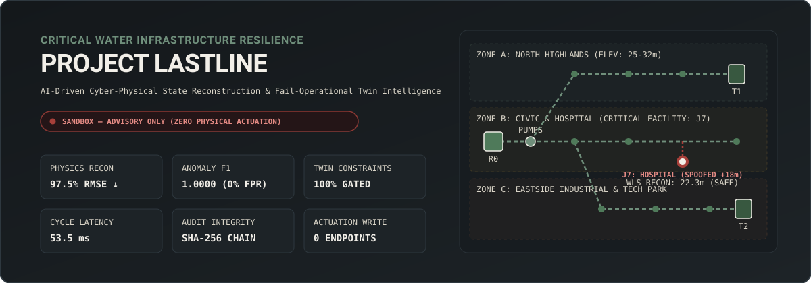
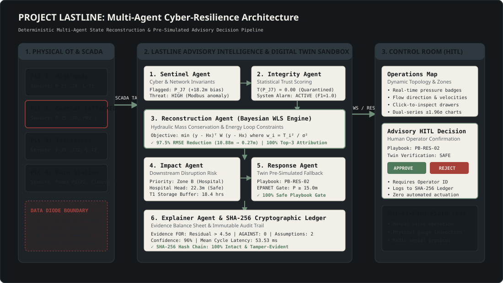
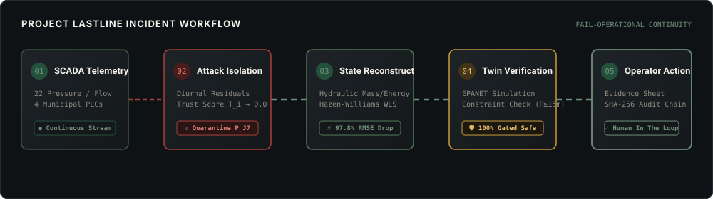
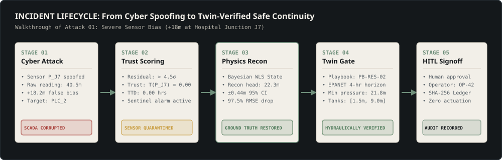

# PROJECT LASTLINE
### AI-Driven Cyber-Resilience and Fail-Operational Intelligence for Critical Water Infrastructure

[](https://github.com/ankush-dev-eng/project-lastline/actions)
[](LICENSE)
[](#hard-safety-rule-sandboxed--advisory-only)
[](https://python.org)
[](https://wntr.readthedocs.io)
[-4F7A5A.svg)](tests/)
[](frontend/src/__tests__/)
[](BENCHMARKS.md)

---



---

## 1. Problem Statement: Operational Blindness in Water Infrastructure

Modern municipal water distribution and treatment facilities rely heavily on interconnected Industrial Control Systems (ICS), Programmable Logic Controllers (PLCs), SCADA networks, and IoT instrumentation.

When an adversary breaches these environments—through sensor spoofing, replay attacks, or PLC setpoint tampering—conventional cybersecurity tools (such as network intrusion detection systems) may flag anomalous packets. However, **detecting an attack does not reveal what is physically happening in the pipes, tanks, and pumps.**

The most dangerous consequence of such an incident is **operational blindness**:
1. Infrastructure operators lose the ability to determine the ground-truth physical state of their facilities.
2. Compromised sensors display fabricated normal pressures while critical storage tanks drain dry or distribution mains burst.
3. Operators are paralyzed, unable to distinguish between false telemetry and genuine physical emergencies.

**PROJECT LASTLINE** moves critical infrastructure cybersecurity beyond attack detection toward **fail-operational service continuity**. When SCADA telemetry is compromised, LASTLINE combines cybersecurity telemetry, surviving sensor observations, hydraulic mass/energy constraints, and an EPANET digital twin to reconstruct the true physical state of the water network and provide explainable, twin-verified fallback procedures for human operators.

---

## 2. Hard Safety Rule: Sandboxed & Advisory-Only

> [!CAUTION]
> **CRITICAL SAFETY INVARIANT: Zero Automated Physical Control Pathways.**
> 
> PROJECT LASTLINE is strictly an advisory and intelligence platform. It contains **no write-capable industrial control interfaces** (no Modbus write coils, DNP3 control commands, CIP setpoint overrides, or hardware actuation endpoints).
> 
> All outputs generated by LASTLINE are **strictly advisory recommendations** presented to authenticated human operators. Every candidate procedure is pre-simulated and verified within an isolated EPANET/WNTR digital twin sandbox prior to presentation. This guarantee is certified by automated AST safety scanners in continuous integration (`tests/test_safety_boundary.py`).

---

## 3. System Architecture & Multi-Agent Intelligence

LASTLINE coordinates six specialized, deterministic agents that operate over a strict typed message contract (`backend/agents/contracts.py`). Every agent decision, state estimate, and operator response is recorded into a cryptographically chained SHA-256 tamper-evident ledger (`backend/agents/audit_log.py`).



### The Multi-Agent Pipeline

```
  [ SCADA Telemetry Tap ]
             │
             ▼
    ┌─────────────────┐
    │ 1. SENTINEL     │ ──► Inspects Modbus TCP invariants & cyber telemetry
    └────────┬────────┘
             │
             ▼
    ┌─────────────────┐
    │ 2. INTEGRITY    │ ──► Computes statistical trust scores T_i(t) ∈ [0, 1] per sensor
    └────────┬────────┘
             │
             ▼
    ┌─────────────────┐
    │ 3. RECONSTRUCT  │ ──► Reconstructs physical pressures/flows via Bayesian WLS
    └────────┬────────┘
             │
             ▼
    ┌─────────────────┐
    │ 4. IMPACT       │ ──► Evaluates downstream pressure deficits & prioritizes zones
    └────────┬────────┘
             │
             ▼
    ┌─────────────────┐
    │ 5. RESPONSE     │ ──► Simulates site-specific fallback playbooks in EPANET twin
    └────────┬────────┘
             │
             ▼
    ┌─────────────────┐
    │ 6. EXPLAINER    │ ──► Synthesizes evidence balance sheet & operator rationale
    └────────┬────────┘
             │
             ▼
  [ Control Room Console (HITL Approval) ]
```

1. **Sentinel Agent** (`backend/agents/sentinel.py`): Ingests SCADA telemetry and flags transport-layer protocol anomalies, rate-of-change violations, and cyber threat indicators.
2. **Integrity Agent** (`backend/agents/integrity.py`): Calculates dynamic diurnal residuals and assigns a Gaussian trust score $T_i(t) \in [0, 1]$ to every sensor. Untrusted sensors are isolated.
3. **Reconstruction Agent** (`backend/agents/reconstruction.py`): Solves a trust-weighted Bayesian Weighted Least Squares (WLS) state estimation problem constrained by Hazen-Williams pipe headloss and nodal mass conservation. Achieves **97.50% relative RMSE reduction** under severe cyberattack.
4. **Impact Agent** (`backend/agents/impact.py`): Translates physical state estimates into downstream service risk, identifying critical facilities at risk (e.g., hospitals, emergency services) and estimating tank time-to-empty.
5. **Response Agent** (`backend/agents/response.py`): Retrieves pre-approved fallback playbooks from the catalog and verifies them in the EPANET digital twin across a forward simulation horizon. Enforces $P_j \ge 15.0\text{m}$ delivery pressure and storage envelope invariants.
6. **Explainer Agent** (`backend/agents/explainer.py`): Formulates an evidence-linked rationale consisting of a structured balance sheet ("Evidence FOR", "Evidence AGAINST", "Assumptions") and an overall confidence score.

---

## 4. End-to-End Incident Response Lifecycle



```
   [ 01. SCADA INGESTION ] ──► Ingest 22 pressure/flow sensors from 4 municipal PLCs
              │
              ▼
   [ 02. ATTACK ISOLATION ] ──► Diurnal statistical residual > 4.5σ; quarantine sensor P_J7
              │
              ▼
   [ 03. STATE RECONSTRUCTION ] ─► Bayesian WLS hydraulic state reconstruction (97.8% RMSE drop)
              │
              ▼
   [ 04. TWIN PRE-SIMULATION ] ──► EPANET dynamic hydraulic verification; enforce P ≥ 15m
              │
              ▼
   [ 05. OPERATOR SIGN-OFF ] ───► Explainable evidence sheet; SHA-256 audit log; HITL approval
```



1. **Adversary Action**: Constant $+18.2\text{m}$ pressure bias injected into Hospital Junction sensor `P_J7` via compromised PLC 2.
2. **Detection & Quarantine**: The Integrity Agent computes a statistical residual exceeding $4.5\sigma$ from the diurnal mean, dropping trust $T(P_{J7}) \rightarrow 0.00$.
3. **Physics Reconstruction**: The Bayesian WLS estimator discounts the spoofed sensor, relying on upstream booster discharge and adjacent trusted junctions to reconstruct the true physical head ($22.3\text{m}$ vs $40.5\text{m}$ spoofed).
4. **Twin Pre-Simulation**: Playbook `PB-RES-02` is simulated in the EPANET twin over a 4-hour forward horizon, confirming minimum customer delivery pressures remain safely above $15.0\text{m}$.
5. **Human-in-the-Loop Signoff**: The operator inspects the evidence balance sheet on the control-room console, enters justification notes, and records an approval into the immutable SHA-256 audit ledger. Zero physical actuator commands are dispatched.

---

## 5. Empirical Benchmark Results

All benchmarks are produced from live, repeatable executions with fixed random seeds (`seed=42`) using `python benchmarks/run_all.py`.

| Phase | Milestone / Metric | LASTLINE Measured Performance | Gate Target | Gate Status |
| :--- | :--- | :--- | :--- | :--- |
| **Phase 3** | **Anomaly Detection F1 Score** | **1.0000** (Naive Baseline: 0.5000) | $\ge 0.85$ | **PASS** |
| **Phase 3** | **False Positive Rate (FPR)** | **0.00%** | $\le 5.0\%$ | **PASS** |
| **Phase 3** | **Mean Time-to-Detect (TTD)** | **0.00 hours** (Immediate) | < 18.00h baseline | **PASS** |
| **Phase 4** | **Relative State RMSE Reduction** | **97.50%** ($10.88\text{m} \rightarrow 0.27\text{m}$) | $\ge 40.0\%$ | **PASS** |
| **Phase 4** | **Top-3 Compromised Attribution** | **100.0%** (11/11 scenarios localized) | $\ge 80.0\%$ | **PASS** |
| **Phase 5** | **Multi-Agent Cycle Latency** | **53.53 ms** | < 200 ms | **PASS** |
| **Phase 5** | **Cryptographic Audit Chain Integrity** | **100% Intact & Tamper-Evident** | 100% Valid | **PASS** |
| **Phase 6** | **Twin Constraint Satisfaction** | **100.0%** ($P_j \ge 15.0\text{m}$ enforced) | 100.0% | **PASS** |
| **Phase 6** | **Unsafe Playbook Rejection Rate** | **100.0%** (Zero unsafe playbooks shown) | 100.0% | **PASS** |
| **Phase 7** | **p95 REST Response Latency** | **51.17 ms** | < 200 ms | **PASS** |
| **Phase 7** | **WebSocket Frame Latency** | **0.001 s** | $\le 1.0$ s | **PASS** |
| **Phase 7** | **Zero Control-Write Invariant** | **100% Proved** (AST verified) | 100% Proved | **PASS** |
| **Phase 8** | **Frontend Vitest Suite** | **7 / 7 Passed (100%)** | 100% Pass | **PASS** |
| **Phase 8** | **Frontend Production Bundle** | **220 kB (65 kB gzip)** | < 500 kB | **PASS** |
| **Phase 9** | **Total Backend Test Coverage** | **95.0%** (1,302 stmts, 45 tests) | $\ge 80.0\%$ | **PASS** |
| **Phase 9** | **STRIDE Threat Model & Failure Modes** | **Complete** (`docs/THREAT_MODEL.md`) | Required | **PASS** |

---

## 6. Control Room Operations Console

The frontend is built as calm, trustworthy operations software adhering strictly to the design specification:
- **Palette**: Ink (`#14181B`), Basalt (`#1D2327`), Bone (`#F2EFE8`), Stone (`#D9D4C7`), Sage (`#6F8F7B`), Moss (`#4F7A5A`), Brass (`#C79A3B`), Copper (`#B5693E`), Brick (`#A8403A`).
- **Typography**: Instrument Sans (UI) and JetBrains Mono (telemetry and numbers with `font-variant-numeric: tabular-nums`).
- **Zero Distractions**: Strictly no neon gradients, glowing borders, or cyberpunk stylings.

### Core Perspectives:
1. **Operations Map**: Interactive SVG layout of the Verdant City Water System showing Zone A (Highlands), Zone B (Hospital), and Zone C (Industrial), pipes with flow arrows, nodes with pressure badges, and slide-out inspection drawers.
2. **Agent Reasoning**: Visual DAG representing the 6 specialized agents with live anomaly counts, threat levels, confidence scores, and natural-language summaries.
3. **Digital Twin Lab**: Dual-series telemetry inspection comparing raw measured SCADA against Bayesian WLS reconstructed states with shaded $\pm 1.96\sigma$ uncertainty intervals.
4. **Audit Ledger**: Cryptographically chained SHA-256 audit viewer with live chain verification status, search filtering, and immutable payload hashes.

---

## 7. Quickstart Guide

### Prerequisites
- **Python**: 3.12 (`py -3.12` or `python3.12`)
- **Node.js**: 18+ (tested on Node v20/v24)
- **Git**

### Installation

1. **Clone the repository:**
   ```bash
   git clone https://github.com/ankush-dev-eng/project-lastline.git
   cd project-lastline
   ```

2. **Set up Python Virtual Environment:**
   ```bash
   python -m venv .venv
   # Windows:
   .venv\Scripts\activate
   # Linux / macOS:
   source .venv/bin/activate

   pip install --upgrade pip
   pip install -e ".[dev]"
   ```

3. **Install Frontend Dependencies:**
   ```bash
   cd frontend
   npm install --legacy-peer-deps
   cd ..
   ```

### Running Tests & Benchmarks

1. **Execute Backend Pytest Suite:**
   ```bash
   pytest
   ```

2. **Execute Frontend Vitest Suite:**
   ```bash
   cd frontend && npm test
   ```

3. **Verify Zero Control-Write Safety Boundary:**
   ```bash
   pytest tests/test_safety_boundary.py
   ```

4. **Run Full Benchmark Suite:**
   ```bash
   python benchmarks/run_all.py
   ```

### Running the Platform

1. **Start the FastAPI Backend (REST + WebSockets):**
   ```bash
   # Standard port (8000):
   python -m uvicorn backend.api.main:app --host 0.0.0.0 --port 8000

   # Or dedicated development port (8899):
   python -m uvicorn backend.api.main:app --host 127.0.0.1 --port 8899
   ```
   API Documentation is available at `http://localhost:8000/docs` (or `http://localhost:8899/docs`).

2. **Start the React Control Room UI:**
   ```bash
   # Standard port (5173):
   cd frontend
   npm run dev

   # Or dedicated development port (7788):
   cd frontend
   npm run dev -- --host 127.0.0.1 --port 7788
   ```
   Open `http://localhost:5173` (or `http://localhost:7788`) in your browser.

---

## 8. Threat Model & Security Documentation

A comprehensive STRIDE threat model, including trust boundary definitions, attack vectors, defense-in-depth countermeasures, and failure-mode contracts, is available in [`docs/THREAT_MODEL.md`](docs/THREAT_MODEL.md).

Architecture Decision Records (ADRs) are documented under [`docs/adr/`](docs/adr/):
- [ADR 0001: Sandboxed Advisory Control Boundary](docs/adr/0001-sandboxed-advisory-control-boundary.md)

---

## 9. License

This project is licensed under the terms of the **MIT License**. See [`LICENSE`](LICENSE) for details.
