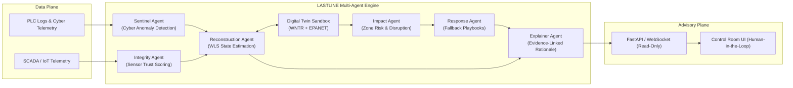

# PROJECT LASTLINE
### AI-Driven Cyber-Resilience and Fail-Operational Intelligence for Critical Water Infrastructure

[](https://github.com/ankush-dev-eng/project-lastline/actions)
[](LICENSE)
[](#hard-safety-rule)
[](https://python.org)
[](https://wntr.readthedocs.io)

---

## The Problem: Operational Blindness in Water Infrastructure

Modern municipal water distribution and treatment facilities rely heavily on interconnected Industrial Control Systems (ICS), Programmable Logic Controllers (PLCs), SCADA networks, and IoT sensors.

When sophisticated cyberattacks breach these environments—such as Stuxnet-style setpoint manipulation, sensor spoofing, or telemetry replays—conventional Intrusion Detection Systems (IDS) detect anomalous network packets, but fail to answer the most urgent questions:

1. **What is the true physical state of the water network right now?**
2. **Which sensors and PLCs are lying, and which can still be trusted?**
3. **Are downstream storage tanks about to run dry, or are distribution mains at risk of catastrophic burst pressure?**
4. **How can human operators safely maintain continuous water service without relying on compromised telemetry?**

**PROJECT LASTLINE** closes this gap. By fusing raw cyber telemetry, independent physical sensor measurements, mass/energy conservation constraints, and an EPANET digital twin, LASTLINE reconstructs the ground-truth physical state of the infrastructure and provides pre-simulated, explainable fallback guidance to human operators.

---

## Hard Safety Rule: Sandboxed & Advisory-Only

> [!CAUTION]
> **Zero Physical Actuation**: PROJECT LASTLINE is strictly an advisory and intelligence platform. It contains **no write-capable industrial control interfaces** (no Modbus write, DNP3 control commands, CIP setpoint write, or physical actuation endpoints). All candidate responses are simulated only within the digital twin sandbox and presented to human operators for manual verification and approval. This architectural guarantee is enforced and audited by automated safety tests.

---

## Architectural Overview



---

## Design System & Control Room Palette

PROJECT LASTLINE avoids neon cyberpunk tropes and generic AI styling. It is built as a focused, calm control-room platform adhering to strict WCAG AA contrast standards.

| Token | Hex | Role | Contrast on Bone |
| :--- | :--- | :--- | :--- |
| **Ink** | `#14181B` | Primary text and deep interface surfaces | > 12:1 |
| **Basalt** | `#1D2327` | Structural panel backgrounds and borders | > 9:1 |
| **Bone** | `#F2EFE8` | Light theme surface background | Base |
| **Stone** | `#D9D4C7` | Subtle dividers and secondary surfaces | 1.3:1 (structural) |
| **Sage** | `#6F8F7B` | Primary brand accent and interactive states | > 4.5:1 |
| **Moss** | `#4F7A5A` | Healthy telemetry and verified states | > 4.5:1 |
| **Brass** | `#C79A3B` | Warning and telemetry drift indicators | > 3.0:1 |
| **Copper** | `#B5693E` | Elevated risk and anomalous sensor clusters | > 4.5:1 |
| **Brick** | `#A8403A` | Critical alerts, compromised PLCs, safety gates | > 5.5:1 |

---

## Directory Structure

```text
project-lastline/
├── backend/            # FastAPI, Pydantic v2, DuckDB, State Estimators
├── frontend/           # Vite, React 18, TypeScript, Tailwind, MapLibre GL
├── twin/               # WNTR + EPANET water network models and simulators
├── data/               # BATADAL dataset loaders and synthetic attack scenarios
├── docs/               # Architecture Decision Records (ADRs) and Threat Model
│   ├── adr/            # Architecture Decision Records
│   └── THREAT_MODEL.md # STRIDE threat model for critical water ICS
├── benchmarks/         # Benchmark runner and empirical verification scripts
├── assets/             # Self-hosted theme-aware SVGs, badges, and diagrams
├── PROGRESS.md         # Autonomous development progress tracker
├── BENCHMARKS.md       # Empirical benchmark results vs naive baselines
└── Makefile            # Monorepo build, test, and verification automation
```

---

## Quickstart (Development)

### Prerequisites
- Python 3.12+
- Node.js 20+
- Git

### 1. Backend Setup
```bash
python -m venv .venv
source .venv/bin/activate  # Or on Windows: .venv\Scripts\activate
pip install -e ".[dev]"
pytest
```

### 2. Frontend Setup
```bash
cd frontend
npm install
npm run dev
```

### 3. Verification & Benchmarking
```bash
# Run tests and verify the complete gate suite
make test
make benchmark
```

---

## License
MIT License. Critical infrastructure resiliency tooling developed for public safety and research.
